# Pyi-thon

<p align="center">
  <strong>Learn Python by writing real code. 30 topics. Zero setup. Completely free.</strong>
</p>

<p align="center">
  <a href="https://pyithon.com"></a>
</p>

<p align="center">
  <a href="https://github.com/aiedwardyi/pyi-thon/actions/workflows/ci.yml"></a>
  
  
  
  
  
  
</p>

---

Pyi-thon is a browser-first Python learning platform built for people who learn best by doing. There is no Python install, no terminal setup, and no dependency rabbit hole - just open the app and start writing code.

It is aimed at complete beginners, but it is also friendly to experienced developers who want a clean, inspectable open source project with a real product feel.

<p align="center">
  <a href="https://pyithon.com"><strong>Try it now &rarr;</strong></a>
</p>

<p align="center">
  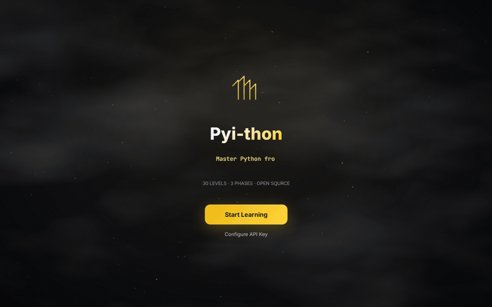
</p>

## Why Pyi-thon?

Most Python tutorials make you read. Pyi-thon makes you write.

- Short reps - copy, write, change, then fix a bug
- No autocomplete - you actually learn the syntax
- Instant feedback - a plain one-line tip when you miss
- Real Python - runs in your browser via WebAssembly
- Gamified - XP, clean-rep combos, a daily streak, confetti
- Free and open source - fork it, customize it, self-host it

## Screenshots

<table>
  <tr>
    <td align="center"><strong>Intro</strong></td>
    <td align="center"><strong>Win Overlay</strong></td>
  </tr>
  <tr>
    <td>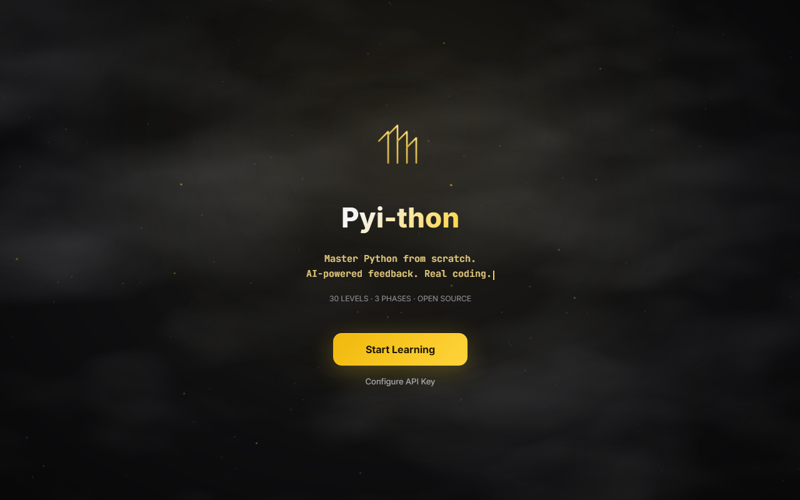</td>
    <td>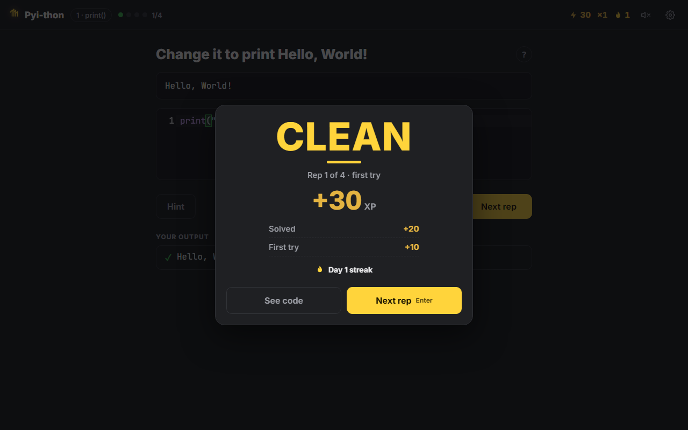</td>
  </tr>
  <tr>
    <td align="center"><strong>Fix the Bug</strong></td>
    <td align="center"><strong>Korean + Light Mode</strong></td>
  </tr>
  <tr>
    <td>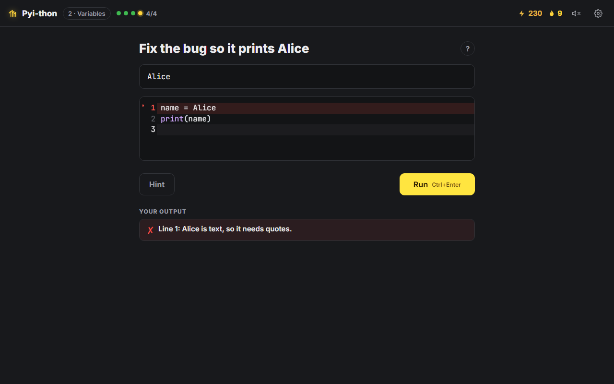</td>
    <td>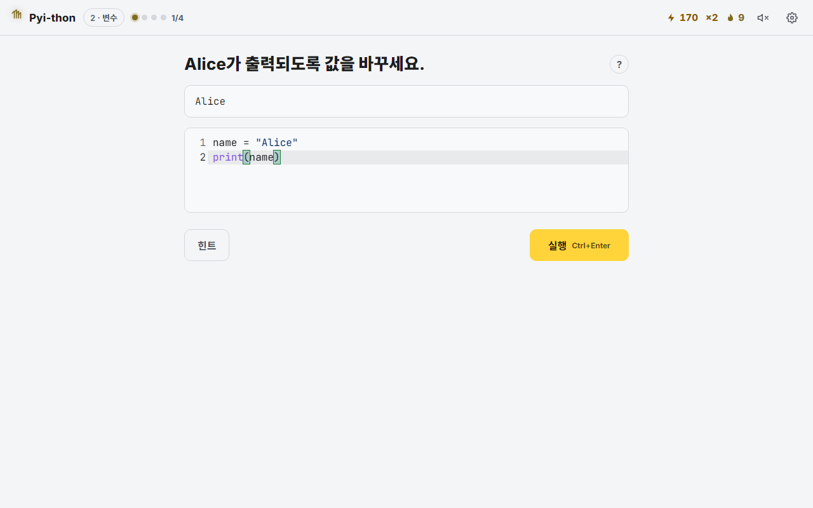</td>
  </tr>
  <tr>
    <td align="center"><strong>All Levels</strong></td>
    <td align="center"><strong>History</strong></td>
  </tr>
  <tr>
    <td>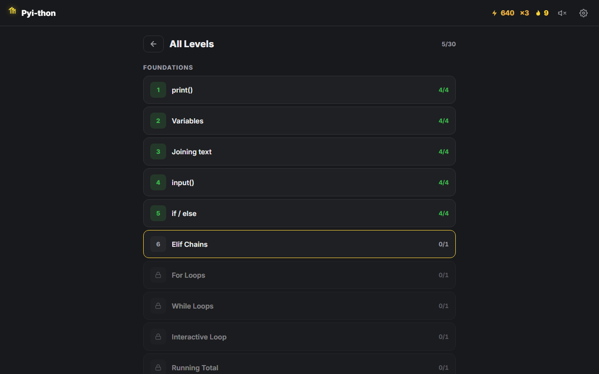</td>
    <td>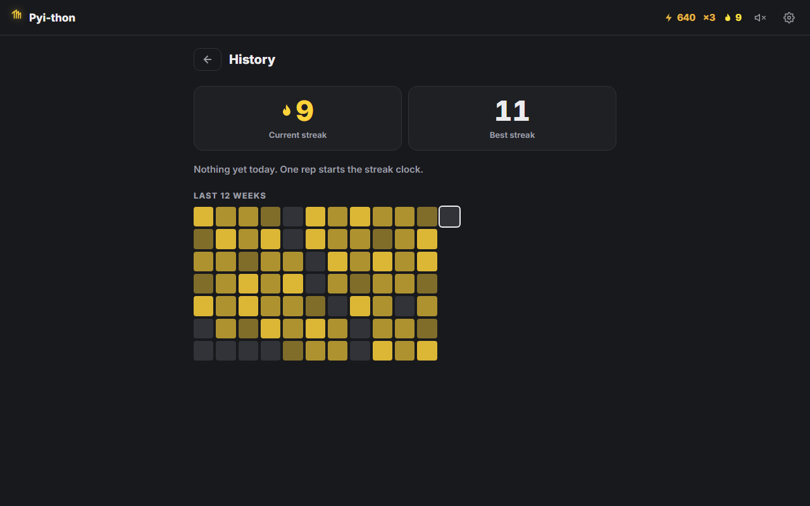</td>
  </tr>
  <tr>
    <td align="center"><strong>Settings &amp; AI Providers</strong></td>
    <td align="center"><strong>Mobile</strong></td>
  </tr>
  <tr>
    <td>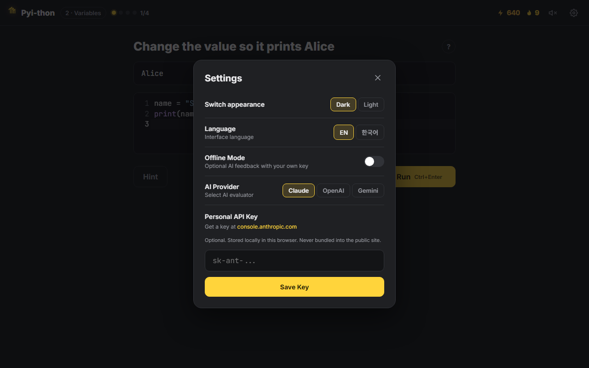</td>
    <td align="center">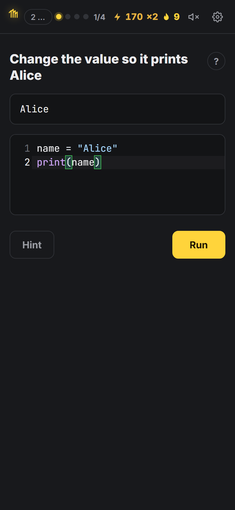</td>
  </tr>
</table>

## Themes

Two themes, Dark and Light, switchable from Settings.

<table>
  <tr>
    <td align="center">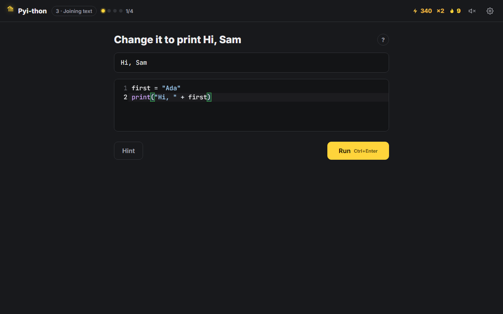<br /></td>
    <td align="center">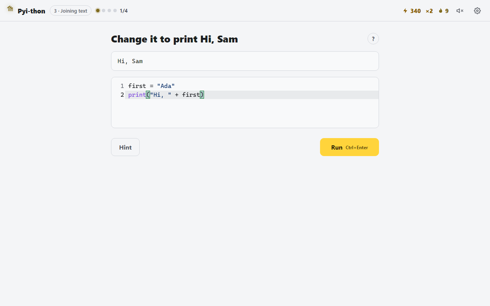<br /></td>
  </tr>
</table>

## Features

| Feature | Description |
|---------|-------------|
| **30 Topics** | From `print("Hello")` to data pipelines across 3 phases. Topics unlock in order |
| **4-Rep Sets** | Topics 1-5 are four short reps: tweak, write, change, fix a bug. Topics 6-30 are one task each |
| **Real Python in Browser** | Pyodide (WebAssembly) runs actual Python 3 - no server needed |
| **Plain Tips** | One short tip per miss, in English or Korean, using only words taught so far |
| **3-Step Hints** | A nudge, then an example, then the answer |
| **Win Moments** | CLEAN, SOLVED, and DONE overlays with an XP count-up, combo, confetti, and optional sounds |
| **Daily Streak** | Flame counter in the top bar and a History screen with a 12-week heatmap |
| **Code Editor** | CodeMirror 6 with Python highlighting. Auto-indents after a colon, including on phones |
| **Bring Your Own AI Key** | Optional Claude, OpenAI, or Gemini feedback after a miss. Local feedback is the fallback |
| **Bilingual** | Full English and Korean (한국어) interface and lesson content |
| **2 Themes** | Dark and Light, with a Python yellow accent |
| **Progress Saving** | Auto-saves to localStorage - close the tab, come back later |
| **Responsive** | Single-column layout that works on desktop and phones |
| **Light Dependencies** | React, Vite, and CodeMirror. No state library, no CSS framework |

## Quick Start

```bash
git clone https://github.com/aiedwardyi/pyi-thon.git
cd pyi-thon
npm install
npm run dev
```

Open the local app at `http://localhost:3000`.

### AI Feedback (Optional)

Pyi-thon works without a key. For extra feedback after a miss, add any one of these:

| Provider | Get a key | Model used |
|----------|-----------|------------|
| **Claude** (default) | [console.anthropic.com](https://console.anthropic.com) | Claude Sonnet |
| **OpenAI** | [platform.openai.com](https://platform.openai.com) | GPT-4o Mini |
| **Google Gemini** | [aistudio.google.com](https://aistudio.google.com) | Gemini 2.0 Flash |

Enter your key in the Settings panel. The key stays in your browser. For public or static deployments, do not put provider secrets into Vite env vars, because `VITE_*` values are embedded into the client bundle.

If you need shared credentials, route AI requests through a server-side proxy instead.

## The 30 Topics

| Phase | Topics | What You Learn |
|-------|--------|---------------|
| **01 - Foundations** | 1-18 | print, variables, joining text, input, if/else, loops, functions, lists, dicts |
| **02 - Real Skills** | 19-25 | mini apps, file I/O, error handling, classes, JSON, imports |
| **03 - Beyond** | 26-30 | list comprehensions, string methods, f-strings, lambda/map, data pipelines |

Each topic opens with a see card: a short rule, an example, and what it prints. Then you write code, with hints on hand.

## How It Works

```
See card  ->  Write code  ->  Run  ->  Pyodide checks the output  ->  Tip or win + XP
```

Your code runs in a fresh Pyodide namespace with a loop guard. The output is checked line by line against the expected result. Each rep can also require or forbid a concept, so hardcoded answers do not pass.

XP is 20 per rep, +10 for a first try, and 50 for finishing a set. Clean reps in a row build a combo. The first rep of each day starts or extends your streak.

For topics that teach `input()`, the lesson types sample inputs for you so the expected output stays reproducible on mobile and desktop.

With an AI key saved, a miss also gets feedback from your chosen provider. Without one, local feedback covers it.

The URL-driven QA/debug mode is limited to local and dev environments so shared production links cannot auto-run test payloads.

## Project Structure

```
pyi-thon/
├── index.html          # Entry point, font imports, Pyodide script
├── package.json        # Scripts and dependencies
├── vite.config.js      # Dev server config
├── .env.example        # Notes about keeping provider keys out of public builds
├── public/             # Icons, manifest, share image
├── test/               # Unit tests and Playwright e2e specs
└── src/
    ├── main.jsx        # React mount point
    ├── App.jsx         # Application orchestration and rep flow
    ├── components/     # Intro, rep screen, editor, win overlay, levels, history, settings
    ├── data/           # App strings, provider config, and topic content
    ├── lib/            # Python runner, feedback checker, progress, streak, storage, AI helpers
    └── theme/          # Theme palettes, intro styles, and shared global styles
```

The app stays intentionally lightweight while keeping obvious responsibilities separated so the source is easier to review.

## Tech Stack

| Technology | Purpose |
|-----------|---------|
| **React 18** | UI rendering |
| **Vite 5** | Dev server, build |
| **CodeMirror 6** | Code editor |
| **Pyodide** | Python 3 in the browser (WebAssembly) |
| **Claude / OpenAI / Gemini** | Optional AI feedback |
| **Playwright** | End-to-end tests |
| **Web Audio API** | Sound effects |
| **localStorage** | Progress + preferences |

No state management library. No CSS framework. No component library.

## Quality And Releases

This repo is meant to stay easy to trust, easy to inspect, and easy to ship.

- Quick maintainer check: `npm run smoke`
- Release-ready changes should pass `npm test`, `npm run build`, and `npm run test:e2e`
- Release candidates should also pass `npm run lint`
- UI changes should be checked on both desktop and mobile widths
- Keep PRs focused so reviews stay fast
- Include screenshots for visual changes when it helps reviewers
- Prefer small, understandable releases over big surprise drops

Versioned releases are published from Git tags such as `v1.0.0`, and the repo includes CI plus release automation so the public history stays easy to follow.

See [CHANGELOG.md](CHANGELOG.md), [RELEASE_CHECKLIST.md](RELEASE_CHECKLIST.md), and [ROADMAP.md](ROADMAP.md) for release history, release steps, and project direction.

## Repo Standards

- [Contributing Guide](CONTRIBUTING.md)
- [Code of Conduct](CODE_OF_CONDUCT.md)
- [Security Policy](SECURITY.md)
- [Support Guide](SUPPORT.md)
- [Roadmap](ROADMAP.md)

## Self-Hosting

Pyi-thon is a static site - deploy it anywhere:

```bash
npm run build    # Outputs to dist/
```

Works with **Vercel**, **Netlify**, **AWS Amplify**, **GitHub Pages**, **Cloudflare Pages**, or any static host. The Pyodide runtime loads from CDN at runtime. Bring-your-own-key AI feedback works directly from the browser; shared provider credentials should live behind a server-side proxy, not in the public bundle.

## Contributing

Contributions are welcome. Whether you are fixing a bug, adding a topic, improving translations, or polishing the UI, the project benefits from clear, well-scoped work.

See [CONTRIBUTING.md](CONTRIBUTING.md) for the contributor guide and the quality bar we use for pull requests.

If you enjoy the app, a star on GitHub helps other programmers discover it.

### Ideas

- More topics - Phase 3 has room to grow (regex, decorators, generators, async)
- More languages - Japanese, Spanish, Chinese, etc.
- More AI providers - Mistral, Groq, local models via Ollama
- Accessibility - screen reader improvements, keyboard navigation
- Challenge mode - timed reps, leaderboards
- Progress export - share your progress, import on another device

## License

[MIT](LICENSE) - use it, fork it, learn from it, teach with it.

---

<p align="center">
  <strong>If Pyi-thon helped you learn Python, give it a star!</strong><br />
  It helps others find this project.
</p>

<p align="center">
  Made by <a href="https://github.com/aiedwardyi">Edward Yi</a>
</p>
